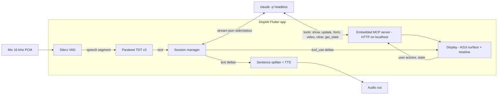

# DisplAI — design (v0)

Status: draft, 2026-11-22. Numbers measured on an Apple M1 Pro (16 GB), macOS 26.6.2.

## 1. What it is

A voice-first desktop assistant for macOS, built with Flutter. You talk; it answers with a short
spoken sentence and shows everything else on screen (cards, tables, forms, video, later 3D).
There is no chat UI.

The brain is the user's own **Claude Code** (their install, their login), running headless
underneath the app. The app gives Claude Code a set of **display tools** through an MCP server
embedded in the app, plus a system prompt that makes it work visually ("speak little, show a lot").

Later, a mobile app acts as a remote for the desktop (Claude Code does not run on phones).

### Principles

- Voice is the primary channel. Every on-screen choice must also be selectable by voice ("la segunda").
- Everything audio runs locally: VAD, STT, TTS, wake word. No cloud speech, no speech-to-speech APIs.
- The model decides what to show; the app owns how it looks (a fixed, themed widget catalog).
- Open source. Models are downloaded on first run, not committed or bundled.

## 2. Architecture



Key point: the app is **both** the reader of Claude Code's output stream **and** the MCP server
that executes the display tools. That lets it react before a tool call finishes (see 5.3).

## 3. Components, checked

All versions checked on 2026-11-22 (pub.dev API, GitHub releases, local runs).

### 3.1 Brain: Claude Code headless

Checked locally with Claude Code **2.1.302**.

- Launch once per session and keep it alive:
  `claude -p --input-format stream-json --output-format stream-json --include-partial-messages --verbose
  --append-system-prompt <visual prompt> --mcp-config <displai.json> --strict-mcp-config`.
- User turns go to stdin as `{"type":"user","message":{"role":"user","content":[...]}}`.
- `--include-partial-messages` gives `stream_event` lines with `text_delta` (for TTS) and
  `input_json_delta` (for progressive display rendering).
- **Interrupt (barge-in) works**: write
  `{"type":"control_request","request_id":"…","request":{"subtype":"interrupt"}}` to stdin. Measured:
  `control_response` success in 2–6 ms, the turn ends with `result` subtype `error_during_execution`
  4–14 ms later, and the session stays usable (next turn answered normally). This is not in the public
  headless docs ([docs](https://docs.claude.com/en/docs/claude-code/headless),
  [docs gap issue](https://github.com/anthropics/claude-code/issues/24594)); third-party wrappers use the
  same envelope (e.g. [claude-wrapper duplex.rs](https://docs.rs/claude-wrapper/0.11.0/src/claude_wrapper/duplex.rs.html)).
  We treat it as a de-facto protocol and keep a SIGINT fallback.
- **Settings isolation matters for latency**: loading the user's full settings (hooks, plugins,
  CLAUDE.md, MCP servers) pushed median time-to-first-text from ~1.6 s to ~6 s in our run. Default:
  `--setting-sources ""` plus our own MCP only; opt-in toggle to load the user's settings.
- Permissions: there is no terminal to answer prompts. Use `--permission-prompt-tool` pointing at a
  DisplAI MCP tool that shows a confirm card and accepts "sí / no" by voice.
- Model: user-selectable; aliases only (`opus`, `sonnet`, `haiku`), never pinned IDs.

### 3.2 Audio: sherpa-onnx

[`sherpa_onnx`](https://pub.dev/packages/sherpa_onnx) **2.0.3** (Dart FFI, macOS supported via
`sherpa_onnx_macos`). Has VAD, offline and streaming ASR, TTS, keyword spotting.

**Breaking fact**: sherpa-onnx **2.0.0 removed espeak-ng and piper-phonemize**
([release notes, PR #4055](https://github.com/k2-fsa/sherpa-onnx/releases/tag/v2.0.0)).
Piper and Kokoro now need phonemes supplied by the caller (`GenerationConfig.phonemeCodepoints`),
i.e. we would have to ship espeak-ng (GPL-3.0) ourselves. Supertonic does not need a phonemizer.

| Piece | Choice | Size | License | Measured on M1 Pro (CPU, 4 threads) |
|---|---|---|---|---|
| VAD | Silero VAD v5 | 2 MB | MIT | 0.15–0.3 ms per 32 ms frame |
| STT | NeMo Parakeet TDT 0.6B **v3** int8 (25 EU languages) | 464 MB | CC-BY-4.0 | 165–225 ms per 2.4–3.1 s utterance; 4/4 test phrases correct |
| STT alt | NeMo FastConformer transducer es int8 | 102 MB | CC-BY-4.0 | 48–73 ms; dropped a leading "Oye" |
| STT alt | Kroko streaming zipformer es | 118 MB | see model card | streaming, but cut the last words in our test |
| TTS | **Supertonic 3** int8 (31 languages incl. es) | 122 MB | code MIT, weights OpenRAIL-M | short sentence ~0.4–0.5 s, RTF ~0.17–0.2; no phonemizer |
| TTS alt | Piper es_ES (miro-high, davefx) | 64 MB | per voice (miro: CC0) | short sentence ~75 ms, RTF ~0.04; **needs espeak-ng** |
| TTS alt | Kokoro v1.0 fp32 (ef_dora, em_alex) | 333 MB | Apache-2.0 | RTF ~0.37 (int8 slower: ~0.6); **needs espeak-ng** |
| Wake word | sherpa-onnx KWS | — | — | only English/Chinese models published |

Notes:
- STT tests used macOS `say` (voice Mónica) as input; Parakeet misheard "bisiesto" once in the e2e
  run. Real-voice accuracy still has to be checked with Jairo's voice.
- Intelligibility of every TTS candidate was checked by transcribing its output with Parakeet
  (30–33 of 33 words). Naturalness needs a human ear: samples in `spike/voice-samples/`.
- CoreML execution provider was slower than CPU for Kokoro and Supertonic on this Mac.
- Audio I/O: [`record`](https://pub.dev/packages/record) 7.2.0 (`startStream`, PCM16, macOS) for the mic,
  [`flutter_soloud`](https://pub.dev/packages/flutter_soloud) 5.3.2 (buffer streams, low latency) for playback.

### 3.3 Display: A2UI via Flutter GenUI

Flutter cannot load arbitrary Dart at runtime, so the display is declarative.

- **Chosen for v0: [`genui`](https://pub.dev/packages/genui) 0.10.4** (Google's GenUI SDK, implements
  the [A2UI v0.9](https://a2ui.org/specification/v0_9/catalogs/basic/catalog.json) protocol). We use only
  its rendering core, not its LLM `Conversation` facade: `SurfaceController.handleMessage(A2uiMessage)`
  applies `createSurface / updateComponents / updateDataModel / deleteSurface`; `Catalog` +
  `CatalogItem` define the widget vocabulary with JSON schemas (which become our MCP tool schemas);
  `DataModel` holds form state; `onSubmit` / `handleUiEvent` give us user actions for `get_state`.
  The basic catalog already has Text, Card, Row/Column/List, Tabs, Modal, TextField, CheckBox,
  ChoicePicker, DateTimeInput, Slider, Image, Video, AudioPlayer.
- Risks: alpha (0.x, breaking renames between 0.9 and 0.10), and `genui` pins `a2ui_core ^0.1.0`
  while `a2ui_core` is already at 0.8.0. Mitigation: keep genui behind one adapter
  (`DisplayController`), pin exact versions.
- A2UI's flat, id-referenced component list is verbose for an LLM to write, and writing tool input
  is the slowest part of a turn (see 4). So we add **high-level catalog items** (`CardList`, `Table`,
  `Stat`, `Form`, `VideoPlayer`, later `Chart`, `Model3D`) so a typical `show` is a few hundred tokens.
- Alternative considered: [`rfw`](https://pub.dev/packages/rfw) 2.0.0 (Remote Flutter Widgets). Compact
  text format, stable, but no data model / form semantics / action events out of the box and models
  know it less. Kept as fallback if genui churns too much.
- Video: `video_player` 2.14.1 for direct URLs (AVPlayer on macOS); YouTube and web pages need a webview
  (out of v0). 3D: [`flutter_scene`](https://pub.dev/packages/flutter_scene) 0.24.3 (Flutter GPU, macOS
  supported) — after v0.

### 3.4 Embedded MCP server

[`mcp_dart`](https://pub.dev/packages/mcp_dart) 2.4.4 has a streamable-HTTP server. The app listens on
`127.0.0.1:<random port>` with a per-session bearer token, and writes the `--mcp-config` JSON pointing
at it. Tools (v0):

| Tool | Purpose |
|---|---|
| `show` | Replace the main surface with a new view (high-level catalog items). Pushes the old view to the timeline. |
| `update` | Patch components or data model of the current view (e.g. mark step done, fill a field). |
| `form` | Show a form and **wait** for submit (by click or voice), return the values. |
| `video` | Play a video URL, with controls the agent can also drive (pause, seek). |
| `clear` | Clear the surface. |
| `get_state` | Compact widget tree of what is on screen, ordinals, form values, last user actions. |

`get_state` output is a compact indented tree, not raw JSON, e.g.:

```
view "Cenas rápidas" (shown 12s ago)
  cardlist
    [1] card "Tortilla francesa" — 10 min
    [2] card "Pasta al pesto" — 15 min  ← user said "la segunda"
    [3] card "Quesadillas" — 12 min
```

## 4. Latency (measured)

Spike: `spike/e2e.py`. A recorded utterance is fed to the VAD in real time; Parakeet transcribes;
a **warm** Claude Code session (display MCP attached, default tools, no user settings) answers;
the first complete sentence goes to TTS. Times are from the real end of speech. Median of 4 prompts.

| Stage (from end of speech) | Opus + Piper | Sonnet + Piper | Opus + Supertonic |
|---|---|---|---|
| VAD closes segment (300 ms silence) | 440 ms | 440 ms | 437 ms |
| STT done | 590 ms | 583 ms | 555 ms |
| First text token | 1.6 s | 1.6–4.0 s * | 2.7 s |
| **First voice ready** (when the model speaks first) | **1.8 s** | **1.8 s** | **3.5 s** |
| Display tool call starts streaming | 1.9 s | 1.5 s | — |
| Display tool call executed | 5.0 s | 3.4 s | 5.0 s |
| Turn done | 6.3 s | 4.1 s | 5.8 s |

\* The model does not always speak first: in some runs it called `show` first and spoke at the end,
pushing first voice to 4–6 s. Runs vary ±1 s between repeats.

Other numbers:
- Cold start (spawn → first answer): ~2 s. The app spawns the session at launch and keeps it warm.
- Text-only turn (no tools at all): first sentence 0.8–1.4 s with warm Opus/Sonnet.
- TTS adds ~0.1 s (Piper) or ~0.5–0.6 s (Supertonic) for the first sentence.

### Mitigations built into v0

1. **Earcon** at VAD end (< 50 ms) so the user knows they were heard.
2. **Thinking strip**: a small live line showing what Claude Code is doing, from stream events
   ("buscando en la web…", tool names mapped to Spanish labels).
3. **Progressive display**: render the `show` call from `input_json_delta` while it streams
   (partial-JSON parse), instead of waiting ~2–3 s for the complete call. This targets the biggest gap.
4. **Speak first**: system prompt rule plus a one-shot example; measure the hit rate. The app cannot
   reorder it (the tool runs before any later text arrives), so this is prompt tuning only.
5. **Sentence-level TTS**: speak each sentence as soon as it is complete; keep synthesis one sentence
   ahead of playback.

## 5. Turn-taking

- v0 is **half-duplex**: mic is muted while TTS plays (no echo cancellation yet).
- Activation: **push-to-talk hotkey** (global, e.g. hold ⌥Space) and a **listening mode** toggle.
  A spoken wake word is not in v0: sherpa-onnx ships only English/Chinese KWS models. Options later:
  English-token wake word ("Hey Display") with the gigaspeech KWS model, or a custom-trained one.
- **Barge-in**: pressing the hotkey (or saying anything once AEC exists) stops TTS and sends the
  interrupt control request. Partial answers stay on the timeline.
- Later: macOS voice processing (`AVAudioEngine` input node with voice processing enabled) for AEC,
  which enables full-duplex and voice barge-in.

## 6. UX

- Full-window display, no chat. Bottom: mic state, thinking strip, last transcript (fades).
- **Timeline**: every `show` pushes the previous view to a horizontal history strip; "vuelve a la
  anterior" works by voice.
- **Ordinals**: every selectable item gets a visible number; `get_state` reports them so the agent can
  resolve "la segunda", "el último", "ese".
- Settings: model alias, voice, input device, hotkey, "use my Claude Code settings" toggle.

## 7. v0 scope

In:
- macOS desktop app (Flutter), single window.
- Claude Code session manager (spawn, warm, stream-json, interrupt, restart on crash).
- Local VAD + Parakeet v3 STT + one TTS voice (pending Jairo's pick), sentence streaming.
- Push-to-talk hotkey, half-duplex, barge-in by hotkey, earcon, thinking strip.
- Embedded MCP with `show`, `update`, `form`, `video`, `clear`, `get_state`.
- A2UI rendering via genui with high-level catalog items; progressive rendering of `show`.
- Timeline of shown views; ordinals for voice selection.
- First-run model download with progress.

Out (later):
- Mobile remote app.
- Spoken wake word, AEC / full-duplex, voice barge-in.
- 3D (`flutter_scene`), charts, webviews/YouTube.
- Windows/Linux builds.
- Multiple sessions, memory beyond what Claude Code already has.

## 8. Open decisions (need Jairo)

1. GitHub repo name and visibility (proposed `kidandcat/displai`, public) and license.
   If the default voice is Supertonic, the app can stay permissive (MIT or Apache-2.0); shipping Piper
   or Kokoro means bundling espeak-ng (GPL-3.0) or asking the user to install it.
2. Default voice: Supertonic 3 (slower, no GPL dependency) vs Piper es_ES (fastest, needs espeak-ng).
3. Default model alias for the brain: `opus` (better, slower display calls) or `sonnet` (faster turns).

## Appendix: spike

`spike/` holds the throwaway scripts (Python + sherpa-onnx 2.0.3 wheel, same native library as the
Dart package): `claude_latency.py`, `bench_audio.py`, `bench_tts2.py`, `e2e.py`, `fake_display_mcp.py`.
Models go to `spike/models/` (git-ignored).
