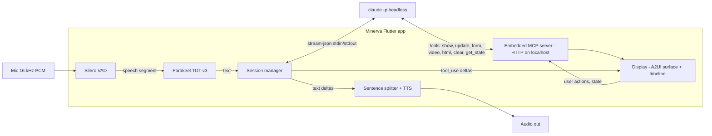

# Minerva — design (v0)

Status: draft, 2026-11-22. Numbers measured on an Apple M1 Pro (16 GB), macOS 26.6.2.

## 1. What it is

A voice-first desktop assistant for macOS, built with Flutter. You talk; it answers with a short
spoken sentence and, when it helps, shows content on screen (cards, tables, forms, video, later 3D).
When nothing is shown, the screen is a living, audio-reactive "presence" animation (JARVIS-style).
There is no chat UI.

The brain is the user's own **Claude Code** (their install, their login), running headless
underneath the app. The app gives Claude Code a set of **display tools** through an MCP server
embedded in the app, plus a system prompt that makes it work visually ("speak little; show when it helps").

A phone app (Android first) acts as a remote for the desktop: mic, speaker and display on the phone,
all processing on the desktop (Claude Code does not run on phones). See §3.7.

### Principles

- Voice is the primary channel. Every on-screen choice must also be selectable by voice ("la segunda").
- Everything audio runs locally: VAD, STT, TTS, wake word. No cloud speech, no speech-to-speech APIs.
- The model decides what to show; the app owns how it looks (a fixed, themed widget catalog).
- Showing is optional. A voice-only answer is fine; the model shows content only when it adds
  something (structure, choices, media, numbers to compare). Otherwise the presence animation stays.
- Open source. Models are downloaded on first run, not committed or bundled.

## 2. Architecture



Key point: the app is **both** the reader of Claude Code's output stream **and** the MCP server
that executes the display tools. That lets it react before a tool call finishes (see 5.3).

## 3. Components, checked

All versions checked on 2026-11-22 (pub.dev API, GitHub releases, local runs).

### 3.1 Brain: Claude Code headless

Checked locally with Claude Code **2.1.302**.

- Launch once per session and keep it alive:
  `claude -p --input-format stream-json --output-format stream-json --include-partial-messages --verbose
  --append-system-prompt <visual prompt> --mcp-config <minerva.json> --strict-mcp-config`.
- Spawn it with a **clean environment**: drop inherited `CLAUDE_CODE_*` / `CLAUDE_*` variables (for
  example, a parent Claude Code session's effort level and session ids leaked into the live test),
  and set the effort level explicitly.
- User turns go to stdin as `{"type":"user","message":{"role":"user","content":[...]}}`.
- `--include-partial-messages` gives `stream_event` lines with `text_delta` (for TTS) and
  `input_json_delta` (for progressive display rendering).
- **Interrupt (barge-in) works**: write
  `{"type":"control_request","request_id":"…","request":{"subtype":"interrupt"}}` to stdin. Measured:
  `control_response` success in 2–6 ms, the turn ends with `result` subtype `error_during_execution`
  4–14 ms later, and the session stays usable (next turn answered normally). This is not in the public
  headless docs ([docs](https://docs.claude.com/en/docs/claude-code/headless),
  [docs gap issue](https://github.com/anthropics/claude-code/issues/24594)); third-party wrappers use the
  same envelope (e.g. [claude-wrapper duplex.rs](https://docs.rs/claude-wrapper/0.11.0/src/claude_wrapper/duplex.rs.html)).
  We treat it as a de-facto protocol and keep a SIGINT fallback.
- **Settings isolation matters for latency**: loading the user's full settings (hooks, plugins,
  CLAUDE.md, MCP servers) pushed median time-to-first-text from ~1.6 s to ~6 s in our run. Default:
  `--setting-sources ""` plus our own MCP only; opt-in toggle to load the user's settings.
- Permissions: Claude Code's own built-in tools are off except `WebSearch`/`WebFetch`
  (`--tools WebSearch,WebFetch`). Everything that touches the Mac is a Minerva tool (see 3.5), which
  runs at once (no confirmations, see the policy in 3.5), so no `--permission-prompt-tool` is needed.
- The brain is meant to be **pluggable** (Codex, Antigravity and others later): the capabilities live in
  Minerva's MCP server, and the brain adapter only has to speak MCP plus a streaming text protocol.
- Model: user-selectable; aliases only (`opus`, `sonnet`, `haiku`), never pinned IDs.
- **One continuous conversation.** The session id lives in Minerva's store; the first start passes
  `--session-id <uuid>`, later starts `--resume <uuid>` (when Claude Code still has the transcript), so the
  conversation survives restarts. `--autocompact 100k` keeps the context small (faster first voice); the
  full history stays searchable in Minerva's own store (§3.6). Each user message is prefixed with the
  local date and time.

### 3.2 Audio: sherpa-onnx

[`sherpa_onnx`](https://pub.dev/packages/sherpa_onnx) **2.0.3** (Dart FFI, macOS supported via
`sherpa_onnx_macos`). Has VAD, offline and streaming ASR, TTS, keyword spotting.

**Breaking fact**: sherpa-onnx **2.0.0 removed espeak-ng and piper-phonemize**
([release notes, PR #4055](https://github.com/k2-fsa/sherpa-onnx/releases/tag/v2.0.0)).
Piper and Kokoro now need phonemes supplied by the caller (`GenerationConfig.phonemeCodepoints`),
i.e. we would have to ship espeak-ng (GPL-3.0) ourselves. Supertonic does not need a phonemizer.

| Piece | Choice | Size | License | Measured on M1 Pro (CPU, 4 threads) |
|---|---|---|---|---|
| VAD | Silero VAD v5 | 2 MB | MIT | 0.15–0.3 ms per 32 ms frame |
| STT | NeMo Parakeet TDT 0.6B **v3** int8 (25 EU languages) | 464 MB | CC-BY-4.0 | 165–225 ms per 2.4–3.1 s utterance; 4/4 test phrases correct |
| STT alt | NeMo FastConformer transducer es int8 | 102 MB | CC-BY-4.0 | 48–73 ms; dropped a leading "Oye" |
| STT alt | Kroko streaming zipformer es | 118 MB | see model card | streaming, but cut the last words in our test |
| TTS (default) | **Supertonic 3** int8 (31 languages incl. es) | 122 MB | code MIT, weights OpenRAIL-M | short sentence ~0.4–0.5 s, RTF ~0.17–0.2; no phonemizer |
| TTS alt | Piper es_ES (miro-high, davefx) | 64 MB | per voice (miro: CC0) | short sentence ~75 ms, RTF ~0.04; **needs espeak-ng** |
| TTS alt | Kokoro v1.0 fp32 (ef_dora, em_alex) | 333 MB | Apache-2.0 | RTF ~0.37 (int8 slower: ~0.6); **needs espeak-ng** |
| Wake word | sherpa-onnx KWS | — | — | only English/Chinese models published |

Notes:
- STT tests used macOS `say` (voice Mónica) as input; Parakeet misheard "bisiesto" once in the e2e
  run. Real-voice accuracy still has to be checked with Jairo's voice.
- Intelligibility of every TTS candidate was checked by transcribing its output with Parakeet
  (30–33 of 33 words). Naturalness needs a human ear: samples in `spike/voice-samples/`.
- CoreML execution provider was slower than CPU for Kokoro and Supertonic on this Mac.
- Audio I/O: a small native plugin (`AVAudioEngine` with voice processing) does both capture and
  playback, so echo cancellation sees the speaker signal (see 5). Supertonic voice: speaker id 1
  (female; ids 0–4 are female, 5–9 male, measured by pitch).

### 3.3 Display: A2UI via Flutter GenUI

Flutter cannot load arbitrary Dart at runtime, so the display is declarative.

- **Chosen for v0: [`genui`](https://pub.dev/packages/genui) 0.10.4** (Google's GenUI SDK, implements
  the [A2UI v0.9](https://a2ui.org/specification/v0_9/catalogs/basic/catalog.json) protocol). We use only
  its rendering core, not its LLM `Conversation` facade: `SurfaceController.handleMessage(A2uiMessage)`
  applies `createSurface / updateComponents / updateDataModel / deleteSurface`; `Catalog` +
  `CatalogItem` define the widget vocabulary with JSON schemas (which become our MCP tool schemas);
  `DataModel` holds form state; `onSubmit` / `handleUiEvent` give us user actions for `get_state`.
  The basic catalog already has Text, Card, Row/Column/List, Tabs, Modal, TextField, CheckBox,
  ChoicePicker, DateTimeInput, Slider, Image, Video, AudioPlayer.
- Risks: alpha (0.x, breaking renames between 0.9 and 0.10), and `genui` pins `a2ui_core ^0.1.0`
  while `a2ui_core` is already at 0.8.0. Mitigation: keep genui behind one adapter
  (`DisplayController`), pin exact versions.
- A2UI's flat, id-referenced component list is verbose for an LLM to write, and writing tool input
  is the slowest part of a turn (see 4). So we add **high-level catalog items** (`CardList`, `Table`,
  `Stat`, `Form`, `VideoPlayer`, later `Chart`, `Model3D`) so a typical `show` is a few hundred tokens.
- Alternative considered: [`rfw`](https://pub.dev/packages/rfw) 2.0.0 (Remote Flutter Widgets). Compact
  text format, stable, but no data model / form semantics / action events out of the box and models
  know it less. Kept as fallback if genui churns too much.
- Video: `video_player` 2.14.1 for direct URLs (AVPlayer on macOS); YouTube and web pages need a webview
  (out of v0). 3D: [`flutter_scene`](https://pub.dev/packages/flutter_scene) 0.24.3 (Flutter GPU, macOS
  supported) — after v0.

### 3.4 Embedded MCP server

[`mcp_dart`](https://pub.dev/packages/mcp_dart) 2.4.4 has a streamable-HTTP server. The app listens on
`127.0.0.1:<random port>` with a per-session bearer token, and writes the `--mcp-config` JSON pointing
at it. Tools (v0):

| Tool | Purpose |
|---|---|
| `show` | Replace the main surface with a new view (high-level catalog items). Pushes the old view to the timeline. |
| `update` | Patch components or data model of the current view (e.g. mark step done, fill a field). |
| `form` | Show a form and **wait** for submit (by click or voice), return the values. Fields of type `secret` are never returned (see 3.9). |
| `video` | Play a video URL, with controls the agent can also drive (pause, seek). |
| `html` | A page the brain programs itself (HTML/CSS/JS in a WebView) when no catalog item fits: games, simulations, custom charts. Theme CSS variables and a `minerva` bridge (`data`, `onData`, `send`, `state`) are injected; the call returns once loaded, with JS errors. Also an inline `html` node inside `show`. |
| `clear` | Clear the surface. |
| `back` | Return to the previous view. |
| `get_state` | Compact widget tree of what is on screen, ordinals, form values, last user actions. |
| `snapshot` | PNG capture of Minerva's own window (display and orb), longest side ≤ 1280 px, so the brain can check how a view looks. |

**The display never scrolls.** A view that does not fit is cut at the bottom (with a fade). The view
measures how much is hidden after layout; `show` / `update` / `form` / `back` then return a warning
with the hidden pixels, and `get_state` adds an `OVERFLOW` line, so the brain shows less or splits
the content into several views.

`get_state` output is a compact indented tree, not raw JSON, e.g.:

```
view "Cenas rápidas" (shown 12s ago)
  cardlist
    [1] card "Tortilla francesa" — 10 min
    [2] card "Pasta al pesto" — 15 min  ← user said "la segunda"
    [3] card "Quesadillas" — 12 min
```

### 3.5 Host tools: commands, files and computer use

Minerva controls the Mac with **its own tools**, served from the same embedded MCP server (not the
brain's built-ins), so any MCP-capable brain gets the same capabilities.

| Tool | Purpose |
|---|---|
| `run_command` | zsh login shell, cwd = home, timeout, output truncated to ~12k chars. |
| `read_file`, `write_file`, `list_dir` | Text files and directories. |
| `screen` | Screenshot of the main display or one window (ScreenCaptureKit), downscaled. |
| `ui_tree` | Compact accessibility tree of the focused window, with `[n]` targets. |
| `click`, `type_text`, `press_key`, `scroll` | CGEvent / AX actions, by `[n]` target or coordinates. |
| `open`, `activate`, `apps`, `windows` | Apps, URLs and files. |
| `minerva_window` | Minerva's own window: `orb` or `full` (see 3.8, it also switches on its own). |
| `vault_list`, `vault_request`, `vault_delete` | Saved credentials, used through `{{vault:name.field}}` placeholders (see 3.9). |

The native side is `macos/Runner/ComputerControl.swift` (method channel `minerva/computer`); it needs
the Accessibility and Screen Recording permissions.

**No confirmations (Jairo's choice): every tool runs at once.** There is no confirm card, no yes/no
step and no `risky` flag; the safety rules live in the prompts instead. The brain's system prompt
(`app/lib/brain/system_prompt.dart`) tells it that the user's messages are local speech-recognition
transcripts (misheard words, homophones, wrong names or numbers, cut-off sentences) and that for
dangerous or very destructive actions (deleting files or data, sending messages or emails, buying or
paying, publishing, overwriting, irreversible commands or clicks) it acts only when the request is
unmistakably clear; if it is ambiguous or might be a misrecognition, it asks briefly by voice first and
waits for the answer. Workers get the same tools without confirmation too (see 3.6).

### 3.6 Memory, history, skills, workers and routines

All of it belongs to Minerva, not to the brain, so another brain provider gets the same data and tools. Data
lives in `~/Library/Application Support/com.kidandcat.minerva/` (`MINERVA_DATA_DIR` overrides it):
`minerva.db` (SQLite, WAL, FTS5 with accent-insensitive tokenizing) and `skills/`.

| Feature | Tools | How it works |
|---|---|---|
| History | `search_history` | Every user message, display or worker/routine event, and spoken reply is saved. Search by words (any word, best ranked) or read around a message id. Covers what auto-compaction removed from the context. |
| Memories | `remember`, `search_memories`, `forget_memory` | Short self-contained facts. `essential` ones (budget 4,000 chars) go into the system prompt at each start; the rest are searched. `remember` with `id` corrects one. |
| Skills | `read_skill`, `save_skill`, `delete_skill` | `skills/<name>/SKILL.md` with name and description front matter. Only the index goes into the system prompt; the brain loads a skill before that kind of task. Deleting runs at once. |
| Workers | `start_worker`, `list_workers`, `worker_status`, `message_worker`, `stop_worker` | Each worker is its own headless Claude Code process (opus, effort medium, `--autocompact 200k`) with its own MCP endpoint: commands and files, read-only memories, history and skills, `report_progress`, plus `Read`, `Glob`, `Grep`, `WebSearch`, `WebFetch`. No display and no mouse or keyboard. Nothing is confirmed: its prompt says to do destructive actions only when the task clearly asks for them, otherwise to leave them out and say so in the report. Its final message is the report, handed to the brain as a `[worker …]` message. Its session is saved, so `message_worker` can continue it later, also after a restart. The status bar shows how many are running. |
| Routines | `create_routine`, `list_routines`, `update_routine`, `delete_routine` | Schedules `once` (local time), `daily` (time, optional weekdays) or `interval` (minutes). Checked every 15 s while the app runs. At the due time the prompt is handed to the brain as a `[routine …]` message. A missed one-time reminder fires late at the next start; recurring runs missed by more than 2 h are skipped. |

Worker reports and routine prompts wait in a queue until the brain is free: not thinking or talking,
and the user not speaking.

### 3.7 Phone remote

The same Flutter app runs on Android as a remote: the phone is the mic, the speaker and the display;
speech recognition, the brain, the voice and all tools stay on the desktop. Same conversation, same memory.

- **Relay** (`relay/`, Go, `wss://minerva.kidandcat.com/ws?role=host|remote`): both sides dial out, so neither
  needs a public address. `Authorization: Bearer <room token>` (≥ 32 chars); the room is `sha256(token)`. It
  forwards frames between the two roles and sends only `{"t":"peer","up":…}`, the newcomer first. A newer
  connection with the same role replaces the old one (close code 4000). `MINERVA_RELAY` overrides the relay URL.
- **Pairing**: the desktop's phone button shows a QR with `minerva://pair?r=<relay>&k=<key>` (key in the
  `kv` table, "Nuevo código" rotates it). The phone scans it or opens the link, and keeps it in `remote.json`.
  The QR is the only place the pairing key is ever shared.
- **End-to-end encryption** (`app/lib/remote/secure_channel.dart`): the relay is untrusted.
  - From the pairing key, HKDF-SHA256 derives the room token (all the relay gets) and a psk that never
    leaves the devices.
  - Each time both sides are up they exchange ephemeral X25519 public keys (`{"t":"hs"}`, the only readable
    frames) and derive per-direction session keys from the X25519 secret with the psk as salt (Noise NNpsk0
    style): a relay that swaps the public keys cannot compute them, and past sessions stay safe if a
    pairing key leaks later (forward secrecy).
  - Every message and audio frame is then a binary frame: 8-byte counter, ChaCha20-Poly1305 ciphertext and
    tag. Receivers drop frames that fail authentication, repeat or go back in the count, and any unencrypted
    message other than the relay's `peer` notices. The link reports the peer as up only after it decrypts
    the other side's sealed `ready`.
  - The relay still sees who is connected and when, and the size and timing of frames.
  - To check it yourself, run the relay with `-tap`: it logs every forwarded frame as the relay sees it.
    `app/test/remote/secure_channel_test.dart` plays a hostile relay (reading, key swap, bit flips, replays,
    injected messages).
- **Protocol** (`app/lib/remote/protocol.dart`), inside the encrypted channel: audio frames are byte 0 =
  kind (1 mic, phone→desktop; 2 voice, desktop→phone) then PCM16LE. JSON messages:
  - desktop→phone: `hello{rate}`, `state{mode,activity,heard,jobs,muted}`, `stop`, `reset`,
    `tool{id?,name,args}` (no id = replay), `partial{name,json}`, `cancel_partial`;
  - phone→desktop: `hello{w,h,platform}`, `result{id,text,error,png?}`, `idle{n}`, `event{text}`,
    `mute{on}`, `vault{name,description,fields}` (a credential typed in a vault form, see 3.9).
- **While the phone is connected the desktop is quiet**: its mic is ignored, the phone's mic feeds the VAD
  and STT, the voice and the earcon go to the phone, and display tools run on the phone (10 s timeout, then
  locally). Brain messages get a `[phone WxH]` prefix so it designs for the phone screen. Mutating display
  calls are logged (last 20 views) and replayed: to the phone when it joins, to the desktop when it leaves.
- **Phone audio** (`VoiceAudio.kt`): `AudioRecord` with the `VOICE_COMMUNICATION` source at 16 kHz and an
  `AudioTrack` for voice communication on the loudspeaker, so the platform's echo processing allows barge-in.
  The phone reports `idle{n}` when the voice it got has played, which ends the desktop's "speaking" state.
- `app/tool/remote_smoke.dart` is a headless remote for testing without a phone.

### 3.8 Desktop service and window states

Minerva runs as a background app on the Mac (`app/tool/install_macos_service.sh`: a LaunchAgent
starts `/Applications/Minerva.app --background` at login, restarts it after a crash, not after a
quit). One window, three states (`MainFlutterWindow.swift`, `lib/app/desktop_window.dart`):

| State | When | Mac mic and speaker | Dock |
|---|---|---|---|
| open | window shown | on | yes |
| hidden | closed, minimized, or started with `--background` | off (audio engine shut down) | no (menu bar item) |
| overlay | a phone is connected | off | no |
| overlay | Minerva works in other apps of the Mac (computer use) | on | no |

- The audio engine runs only while the window is open, no phone is connected and `MINERVA_NO_MIC` is
  unset; otherwise it is shut down, so macOS shows no mic in use.
- **Overlay**: a 132 pt round window with the orb, floating above other apps on every Space,
  top-right by default (as in the normal window). The native window handles the mouse: a click mutes, a drag moves it
  (position kept in `overlayOrigin`), a right click opens the menu. The orb never keeps the
  keyboard: entering it and clicking it give the focus back to the last other app in front. When
  the phone leaves it goes back to open or hidden.
- **Using the Mac**: with the window open, the first computer-use action on the screen (`click`,
  `type_text`, `press_key`, `scroll`, `open`, `activate`, `screen` of the whole display) turns the
  window into the orb, so it neither covers the app nor takes its keyboard; the Mac keeps listening
  and speaking. It comes back when the brain shows something (`show`, `html`, `form`, `video`,
  `back`), when the brain calls `minerva_window full` (the user asks for it), or when the user opens
  it from the menu bar, Spotlight or Finder. `screen` leaves Minerva's own windows out.
- The Flutter engine starts headless, before any window is shown. A second launch asks the running
  instance to show its window and exits. App Nap is disabled so routines and the relay keep their timers.

### 3.9 Credential vault

Minerva keeps its own credential vault (not the macOS Keychain: no system dialogs) so the brain can
log in, call APIs or fill passwords **without ever seeing a value** (`app/lib/vault/`).

- **Storage**: `<dataDir>/vault/` (mode 0700). `vault.bin` is the JSON of all credentials sealed with
  AES-256-GCM (`MNV1` magic, 12-byte nonce, ciphertext, tag; fixed AAD); `key` is a random 32-byte key
  (mode 0600) created on the first save. Both are written atomically (temp file + rename). A credential
  is a slug name, a description and named fields, each secret or not.
- **Asking**: `vault_request {name, description, fields:[{name,label,secret}]}` shows a form (the normal
  form renderer, with a `secret` field type: obscured, with a show/hide toggle). The call returns at
  once. On submit the values go straight to the vault and the form is wiped; the brain only gets
  `[display] saved credential <name> (fields …)` (or `… cancelled`). Vault forms cannot be changed with
  `update`, and `get_state` shows their fields as `•••`. On the phone the submission travels as
  `vault{…}` over the encrypted remote link, never as an `event`. `vault_list` gives names,
  descriptions and field names; `vault_delete` removes one. The bottom bar's key button lists them
  (no reveal) and deletes them.
- **Placeholders**: the brain writes `{{vault:name.field}}`. `write_file` content and `type_text` get the
  value in place. `run_command` instead gets each placeholder rewritten to an environment variable
  reference (`"${MINERVA_VAULT_1}"`, adapted to the quoting around it) and the value passed in the
  child's environment, so it is not in the command line (`ps`) or a shell history. An unknown
  placeholder is a tool error naming it. Workers get `vault_list` and the same substitution.
- **Redaction**: every result of Minerva's tools (brain and workers) is scrubbed: each stored secret
  value of 4+ characters (also JSON-escaped and URL-encoded) becomes its placeholder. Values of deleted
  credentials stay in the scrub list until restart. `type_text` does not report the typed length.
  `snapshot` draws secret fields obscured even if the user revealed them.
- **Threat model**: it keeps values out of what goes to Anthropic (prompts, tool results), the
  conversation history (`minerva.db`), the logs and the display readback. It is not protection against
  someone with the user's account: the key file sits next to the data, protected only by file
  permissions, like the rest of Minerva's data. Nor against a brain that sets out to exfiltrate them
  (e.g. a command that sends a placeholder's value somewhere, or decrypts the vault itself): the prompt
  rules and scrubbing make leaks unlikely, not impossible. Not scrubbed: images (`screen` of another
  app showing a password), the Claude built-ins `Read`/`Grep` of workers on a file that holds a value,
  and values shorter than 4 characters.

## 4. Latency (measured)

Spike: `spike/e2e.py`. A recorded utterance is fed to the VAD in real time; Parakeet transcribes;
a **warm** Claude Code session (display MCP attached, default tools, no user settings) answers;
the first complete sentence goes to TTS. Times are from the real end of speech. Median of 4 prompts.

| Stage (from end of speech) | Opus + Piper | Sonnet + Piper | Opus + Supertonic |
|---|---|---|---|
| VAD closes segment (300 ms silence) | 440 ms | 440 ms | 437 ms |
| STT done | 590 ms | 583 ms | 555 ms |
| First text token | 1.6 s | 1.6–4.0 s * | 2.7 s |
| **First voice ready** (when the model speaks first) | **1.8 s** | **1.8 s** | **3.5 s** |
| Display tool call starts streaming | 1.9 s | 1.5 s | — |
| Display tool call executed | 5.0 s | 3.4 s | 5.0 s |
| Turn done | 6.3 s | 4.1 s | 5.8 s |

\* The model does not always speak first: in some runs it called `show` first and spoke at the end,
pushing first voice to 4–6 s. Runs vary ±1 s between repeats.

Other numbers:
- Cold start (spawn → first answer): ~2 s. The app spawns the session at launch and keeps it warm.
- Text-only turn (no tools at all): first sentence 0.8–1.4 s with warm Opus/Sonnet.
- TTS adds ~0.1 s (Piper) or ~0.5–0.6 s (Supertonic) for the first sentence.
- **Live test** (`spike/live.py`: Jairo's real voice, MacBook mic and speakers, Opus, Supertonic, no
  tools, 0.4 s end-of-turn silence): first voice **1.8–2.7 s** after the end of speech in 11 of 12
  turns, worst 3.7 s; STT 0.46–0.74 s.

### Mitigations built into v0

1. **Earcon** at VAD end (< 50 ms) so the user knows they were heard.
2. **Thinking strip**: a small live line showing what Claude Code is doing, from stream events
   ("buscando en la web…", tool names mapped to Spanish labels).
3. **Progressive display**: render the `show` call from `input_json_delta` while it streams
   (partial-JSON parse), instead of waiting ~2–3 s for the complete call. This targets the biggest gap.
4. **Speak first**: system prompt rule plus a one-shot example; measure the hit rate. The app cannot
   reorder it (the tool runs before any later text arrives), so this is prompt tuning only.
5. **Sentence-level TTS**: speak each sentence as soon as it is complete; keep synthesis one sentence
   ahead of playback.

## 5. Turn-taking

Tested live on the Mac with `spike/live.py` (real mic, speakers, Opus): works full-duplex with voice
barge-in.

- **Full-duplex with echo cancellation.** Audio runs through macOS voice processing: an
  `AVAudioEngine` whose input node has `setVoiceProcessingEnabled(true)`. Capture **and** playback
  must go through the same engine, because the canceller needs the speaker signal as its reference;
  so TTS is played by this engine, not by a separate audio player. Measured: while a 9 s sentence
  played on the MacBook speakers, Silero VAD flagged 0 of 289 windows as speech.
  Spike helper: `spike/audioio/` (Swift CLI; the v0 app turns it into a small macOS plugin).
  - Gotcha: touch `engine.outputNode` / `mainMixerNode` **before** enabling voice processing, or the
    output unit fails to initialize (`-10875`).
  - The voice-processed input reports 9 channels at 48 kHz on an M1 Pro; channel 0 is the processed
    mic. Resample to 16 kHz for VAD/STT.
- **Voice barge-in.** The mic is always listening. If the VAD sees 0.3 s of continuous speech while
  the assistant is thinking or speaking: stop playback, drop queued sentences, send the stream-json
  `interrupt`. The new utterance becomes the next turn. Partial answers stay on the timeline.
- **Mid-sentence pauses (continuation merge).** End of turn is 0.4 s of silence, which sometimes
  splits a sentence at a natural pause. If the user resumes talking before the answer is audible,
  or within 2 s after it started, the barge-in is treated as a continuation: the previous transcript
  and the new one are merged and sent as one turn. Latency stays low and split sentences are fixed;
  tested live.
- **Activation**: always listening while the app runs. **Space** toggles mute while the window has
  focus (not while a form text field has focus); the status-bar mic button does the same. A global
  push-to-talk hotkey (e.g. hold ⌥Space) is planned after v0. A spoken wake word is not in v0: sherpa-onnx ships
  only English/Chinese KWS models. Options later: English-token wake word ("Hey Display") with the
  gigaspeech KWS model, or a custom-trained one.
- Known STT issue: Parakeet v3 detects the language itself, and very short fragments ("for",
  "Yeah") are sometimes decoded as English. To try: re-run short segments with the Spanish-only
  FastConformer model, or bias with a language hint if sherpa-onnx exposes one.

## 6. Presence animation

When no view is shown (startup, after `clear`, or after a voice-only answer), the window shows a
full-screen JARVIS-style animation that reacts to sound. It is the app's "face".

- **Rendering: a fragment shader** (GLSL `.frag` declared under `flutter: shaders:` in `pubspec.yaml`,
  loaded with `FragmentProgram.fromAsset`, drawn by a `CustomPainter` that sets uniforms every frame).
  Impeller is the renderer on macOS, so this runs on the GPU. A pure `CustomPainter` (Canvas paths,
  blurs) is the fallback, but glow, noise fields and many particles are far cheaper in a shader.
- **Look (first pass, to iterate with Jairo)**: a central core with concentric, segmented rings
  rotating at different speeds, a soft bloom, a field of faint particles/scan lines, cyan on
  near-black. Rings deform radially with the audio spectrum; the core brightness follows loudness.
- **Uniforms**: `uTime`, `uResolution`, `uLevel` (smoothed RMS, 0–1), `uBands` (8 spectrum bands
  passed as two `vec4`), `uState` (idle / listening / thinking / speaking, cross-faded),
  `uAccent` (color).
- **Audio sources**:
  - *Speaking*: level and FFT of the TTS samples, computed in Dart from the PCM we hand to the native
    audio engine and aligned with the engine's playback position, so the animation follows the voice
    that is actually playing. (Playback cannot use `flutter_soloud`: it must go through the
    voice-processing engine for echo cancellation, see §5.)
  - *Listening*: RMS and a small FFT (512 samples) computed in Dart from the mic PCM stream we
    already read for VAD.
  - *Thinking*: no audio; a procedural pulse plus a sweep whose speed follows stream activity
    (text and tool deltas arriving).
  - *Idle*: slow breathing.
  Values are smoothed with attack/release envelopes so motion feels organic, not jittery.
- **Transitions**: when `show` arrives, the presence shrinks into a small orb in the status bar
  (it keeps reacting to the voice there) and the view fades in; on `clear` it expands back.
- Budget: the shader must stay well under a frame at 60 fps on an M1 at full window size; measure
  with the performance overlay during v0.

## 7. UX

- Full-window display, no chat. Bottom: mic state, thinking strip, last transcript (fades).
- **Timeline**: every `show` pushes the previous view to a horizontal history strip; "vuelve a la
  anterior" works by voice, and the **left / right arrow keys** move between views (not while typing
  in a field).
- **No scrolling**: one view = one screen; long content is split into several views.
- **Ordinals**: every selectable item gets a visible number; `get_state` reports them so the agent can
  resolve "la segunda", "el último", "ese".
- Settings: model alias, voice, input device, hotkey, "use my Claude Code settings" toggle.

## 8. v0 scope

In:
- macOS desktop app (Flutter), single window.
- Claude Code session manager (spawn, warm, stream-json, interrupt, restart on crash).
- Local VAD + Parakeet v3 STT + Supertonic 3 TTS, sentence streaming.
- Native macOS audio plugin (voice processing: echo-cancelled capture + playback).
- Full-duplex with voice barge-in and continuation merge; Space mute toggle; arrow-key navigation; earcon; thinking strip.
- Embedded MCP with `show`, `update`, `form`, `video`, `clear`, `back`, `get_state`, `snapshot`, plus the host
  tools (§3.5), which run without confirmations (the prompts carry the safety rules).
- A2UI rendering via genui with high-level catalog items; progressive rendering of `show`.
- Timeline of shown views; ordinals for voice selection.
- Presence animation (fragment shader) reacting to mic and TTS audio, with the shrink-to-orb
  transition when a view is shown.
- First-run model download with progress.
- Persistent, auto-compacting conversation; memories, history search, skills, background workers and
  routines (§3.6).

- Android phone remote through the relay (§3.7).

Out (later):
- iOS phone remote.
- Spoken wake word.
- 3D (`flutter_scene`), charts, webviews/YouTube.
- Windows/Linux builds.
- Routines that run while the app is closed (a launch agent).

## 9. Decisions

1. Repo `kidandcat/minerva`, public, **MIT** license.
2. Default voice: **Supertonic 3** (no phonemizer, so no GPL espeak-ng dependency). Piper/Kokoro stay
   possible later as an opt-in that uses a user-installed espeak-ng.
3. Default model alias: **`opus`**; user can switch to `sonnet` / `haiku` in settings.

## Appendix: spike

`spike/` holds the throwaway scripts (Python + sherpa-onnx 2.0.3 wheel, same native library as the
Dart package): `claude_latency.py`, `bench_audio.py`, `bench_tts2.py`, `e2e.py`, `fake_display_mcp.py`,
and `live.py` (live mic → Claude → speakers loop with barge-in) with its Swift audio helper `audioio/`
(build: `swiftc -O spike/audioio/main.swift -o spike/audioio/audioio`).
Models go to `spike/models/` (git-ignored).
